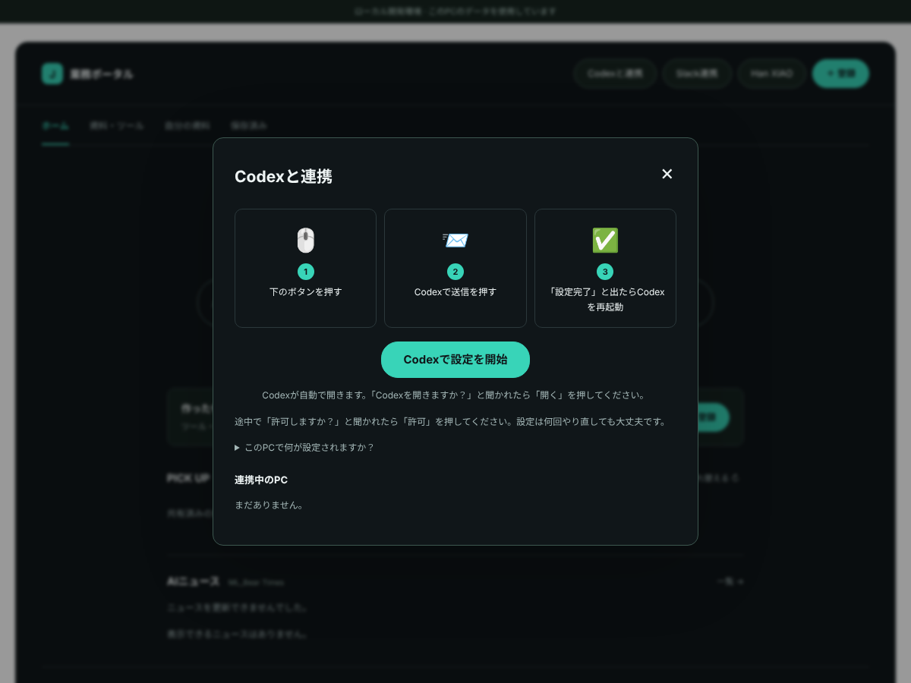
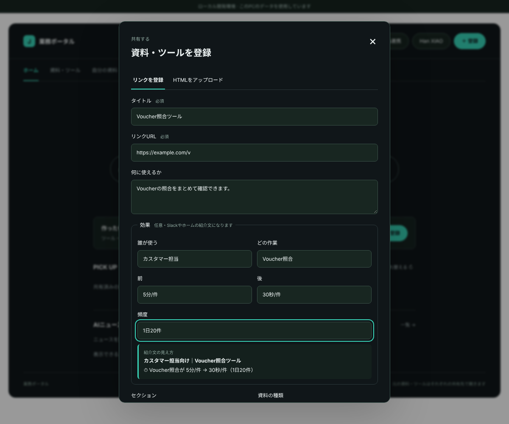
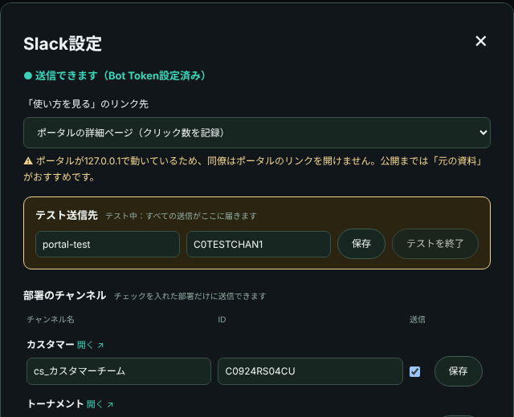
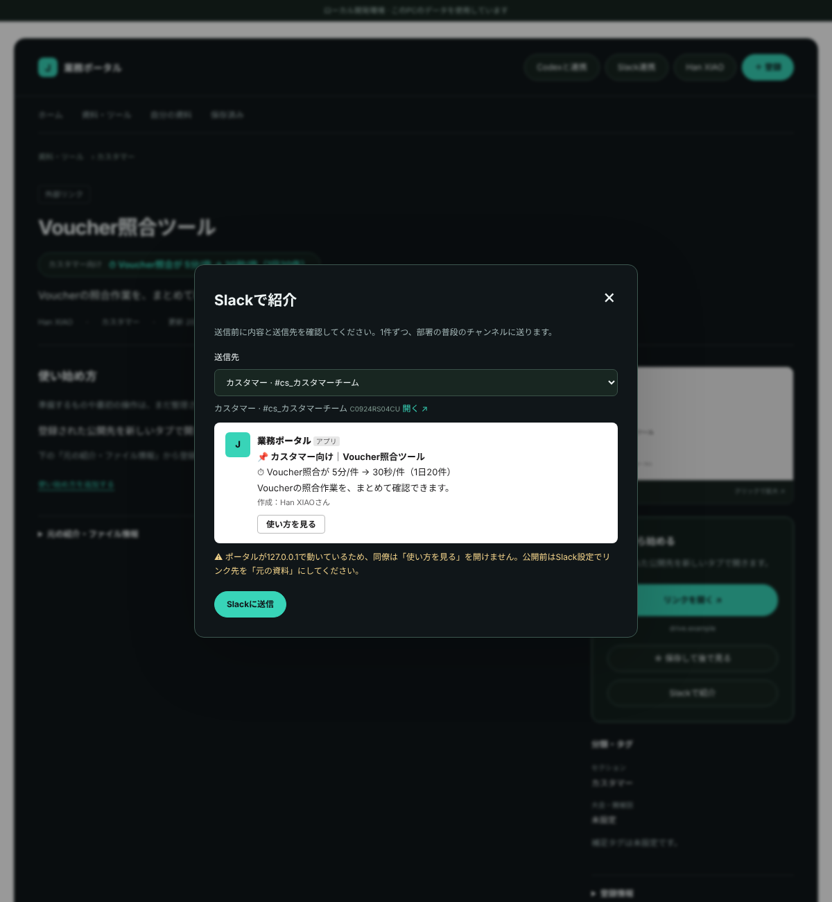
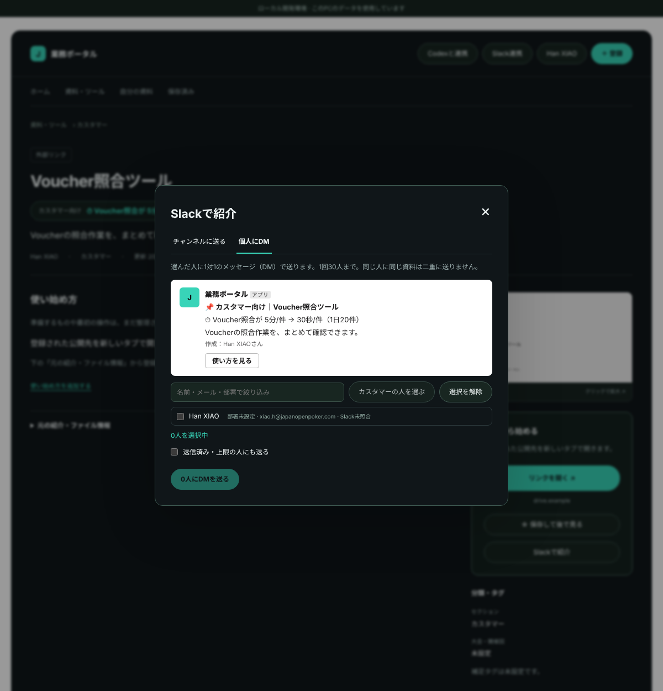
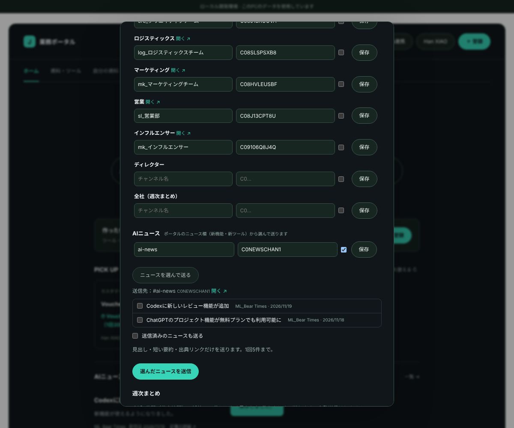

# 测试清单

一步一个勾。不对就截图。

## 0. 准备

- [ ] `.env.local` 有 `SLACK_BOT_TOKEN`
- [ ] `.env.local` 加 `SLACK_WORKSPACE_URL=https://jopthq.slack.com`
- [ ] Slack 建频道 `#portal-test`（只有自己）
- [ ] `npm run dev` → 打开 `http://127.0.0.1:8788`

## 1. Codex 连接

- [ ] 右上「Codexと連携」→「Codexで設定を開始」
- [ ] Codex 打开 → 按发送 → 弹批准就按允许
- [ ] 看到 `SETUP COMPLETE`
- [ ] 重启 Codex，说「Voucher関連の資料を探して」→ 它去门户检索

## 2. 效果一行

- [ ] 「＋登録」→ 填「効果」5 项 → 下面出现预览
- [ ] 登录后，详情页标题下有绿色一行

## 3. 测试频道

- [ ] 「Slack連携」→「テスト送信先」填 `#portal-test` 的 ID → 保存
- [ ] 出现黄框

## 4. 频道介绍

- [ ] 详情页「Slackで紹介」→ 看预览 → 送信
- [ ] `#portal-test` 收到
- [ ] 点「使い方を見る」→ 打开门户
- [ ] 「Slack連携」→ 送信履歴 → 点击数 +1

## 5. DM

- [ ] 「Slackで紹介」→「個人にDM」→ 选自己 → 送
- [ ] `#portal-test` 收到「本番では…にDM」

## 6. 新闻

- [ ] 「Slack連携」→「AIニュース」→「ニュースを選んで送る」→ 选 1 条 → 送
- [ ] `#portal-test` 收到

## 7. 周报

- [ ] 「まとめをプレビュー」→ 送信 → `#portal-test` 收到

## 8. Codex 每周提醒

- [ ] Codex 开新对话 → 提一次新资料/新闻
- [ ] 再开新对话 → 什么都不提

## 9. 结束

- [ ] 「Slack連携」→「テストを終了」
